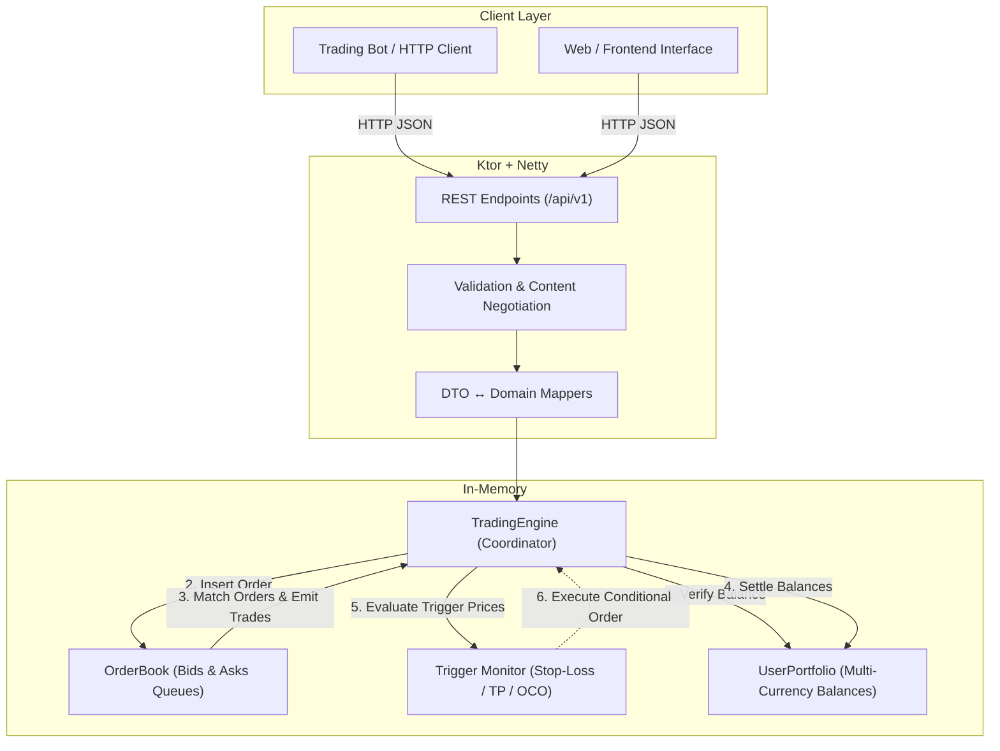
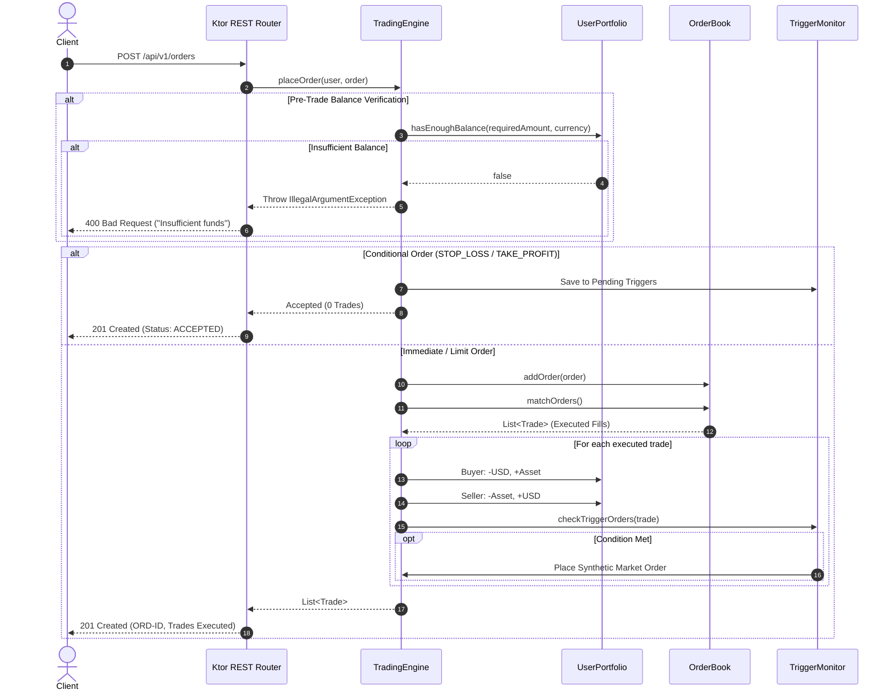

<div align="center">

# 🪙 Kotlin Trading Engine

**An in-memory order matching engine and asynchronous REST API built with Kotlin 2.0, Ktor, and Netty.**

A clean, domain-driven exchange core implementing a continuous double-auction order book, Price-Time priority (FIFO), deterministic order execution (Limit, Market, Stop-Loss, Take-Profit, OCO), and atomic balance accounting.

> ⚠️ **Project Status: Active Development / Portfolio Prototype**  
> This project demonstrates core exchange mechanics, algorithmic order matching, and clean architecture on the JVM. See the [Technical Trade-offs & Planned Evolutions](#-technical-trade-offs--planned-evolutions) section for current design choices and migration paths.

[](https://kotlinlang.org/)
[](https://adoptium.net/)
[](https://ktor.io/)
[](https://gradle.org/)
[](#-project-status)
[](#license)

</div>

---

## 📑 Table of Contents

- [Overview](#-overview)
- [How It Works (System Architecture)](#-how-it-works-system-architecture)
- [Order Lifecycle & Execution Logic](#-order-lifecycle--execution-logic)
  - [Supported Order Types](#supported-order-types)
  - [OCO (One-Cancels-the-Other) Orchestration](#oco-one-cancels-the-other-orchestration)
  - [Pre-Trade Balance Checks & Settlement](#pre-trade-balance-checks--settlement)
- [Technical Trade-offs & Planned Evolutions](#-technical-trade-offs--planned-evolutions)
  - [Why `BigDecimal` is used now & What will replace it](#1-why-bigdecimal-is-used-now--what-will-replace-it)
  - [Why `mutableListOf` is used now & What will replace it](#2-why-mutablelistof-is-used-now--what-will-replace-it)
  - [Concurrency & Concurrency Model](#3-concurrency--concurrency-model)
- [Project Directory Structure](#-project-directory-structure)
- [REST API Specification (v1)](#-rest-api-specification-v1)
- [Getting Started & Local Setup](#-getting-started--local-setup)
- [End-to-End Simulation Walkthrough](#-end-to-end-simulation-walkthrough)
- [Testing & Verification](#-testing--verification)
- [Roadmap & Planned Next Steps](#-roadmap--planned-next-steps)
- [License](#-license)

---

## 📌 Overview

This project is an in-memory **Order Matching & Trading Engine** designed to explore the mechanics behind modern financial exchanges and cryptocurrency spot markets.

Rather than relying on third-party trading libraries, the matching logic, order books, and balance ledgers are implemented from scratch in pure Kotlin, exposed via an asynchronous REST API built with Ktor.

### Key Goals
- **Financial Precision:** Absolute protection against floating-point rounding errors.
- **Fair Execution:** Price-Time Priority (FIFO) matching — best prices match first, timestamp acts as tie-breaker.
- **Clean Architecture:** Strict boundary separation between external JSON transport DTOs and internal domain entities.
- **Advanced Order Strategies:** Native handling of Limit, Market, Stop-Loss, Take-Profit, and linked OCO orders.

---

## 🏗️ How It Works (System Architecture)

The system is split into two primary layers: the **REST Gateway** (network I/O, routing, and serialization) and the **Core Engine** (order matching, trigger monitoring, and balance ledger).



### Order Execution Sequence



---

## 🛡️ Order Lifecycle & Execution Logic

### Supported Order Types

- **`LIMIT`**: A price-capped order. Enters the book and matches against existing opposing orders at the specified limit price or better. Unfilled balance rests in the queue.
- **`MARKET`**: Aggressive liquidity-taking order. Sweeps opposing orders immediately at current market depth. Rejects if opposing liquidity is empty.
- **`STOP_LOSS`**: Conditional risk mitigation order. Remains off-book until an executed trade crosses the stop price threshold, then fires as a `MARKET` order:
  - *Sell Stop-Loss:* Fires when $\text{Market Price} \le \text{Stop Price}$.
  - *Buy Stop-Loss:* Fires when $\text{Market Price} \ge \text{Stop Price}$.
- **`TAKE_PROFIT`**: Conditional profit-securing order:
  - *Sell Take-Profit:* Fires when $\text{Market Price} \ge \text{Target Price}$.
  - *Buy Take-Profit:* Fires when $\text{Market Price} \le \text{Target Price}$.

### OCO (One-Cancels-the-Other) Orchestration

An OCO group connects two conditional orders (e.g., Take-Profit and Stop-Loss) under a shared `ocoGroupId`:

```
                 ┌────────────────────────────────┐
                 │       OCO Order Pair Placed    │
                 │  (Take-Profit + Stop-Loss)     │
                 └───────────────┬────────────────┘
                                 │
                     Market Price Changes
                                 │
         ┌───────────────────────┴───────────────────────┐
         ▼                                               ▼
┌──────────────────────────────┐                ┌──────────────────────────────┐
│  Take-Profit Price Triggered │                │   Stop-Loss Price Triggered  │
├──────────────────────────────┤                ├──────────────────────────────┤
│ 1. Fire Market Order         │                │ 1. Fire Market Order         │
│ 2. Remove linked Stop-Loss   │                │ 2. Remove linked Take-Profit │
└──────────────────────────────┘                └──────────────────────────────┘
```

When either order triggers or is manually cancelled, the matching engine purges the counterpart order to eliminate double-spend risk.

### Pre-Trade Balance Checks & Settlement

Before any order is placed on the order book:
1. **Buy Order:** The engine verifies that user has $\text{Free USD} \ge \text{Price} \times \text{Quantity}$.
2. **Sell Order:** The engine verifies that user has $\text{Free Base Asset} \ge \text{Quantity}$.
3. **Settlement:** When trades match, `processTrade()` synchronously shifts balances between buyer and seller wallets.

---

## ⚖️ Technical Trade-offs & Planned Evolutions

A key part of developing this project is understanding **why certain choices were made for this version** and **how they will be refactored for production-grade speed**.

### 1. Why `BigDecimal` is used now & What will replace it

- **Current Choice (`java.math.BigDecimal`):**  
  Standard `Double` or `Float` cannot be used in financial applications due to IEEE 754 representation issues (e.g., `0.1 + 0.2 = 0.30000000000000004`), which lead to penny-rounding discrepancies. `BigDecimal` guarantees exact decimal arithmetic.
- **The Drawback:**  
  `BigDecimal` is an immutable heap object. Every arithmetic operation (`+`, `-`, `*`) creates new heap allocations, leading to Garbage Collector (GC) churn and cache misses under high throughput.
- **Future Replacement:**  
  **Fixed-Point Integer Representation (`Long` / Kotlin `value class`):**  
  Representing prices and quantities as 64-bit integer units scaled by a fixed multiplier (e.g., $10^8$ for Bitcoin satoshis or $10^4$ for fiat cents/basis points):
  ```kotlin
  @JvmInline
  value class Price(val raw: Long) // Zero heap allocation, register-speed math
  ```
  This eliminates 100% of arithmetic heap allocations while preserving exact integer precision.

### 2. Why `mutableListOf` is used now & What will replace it

- **Current Choice (`mutableListOf` + sort):**  
  Simple and expressive for prototyping order matching logic.
- **The Drawback:**  
  Sorting the list on every insertion is $\mathcal{O}(N \log N)$, and deleting an order is a linear scan $\mathcal{O}(N)$.
- **Future Replacement:**  
  **Price-Level Bucketing (`TreeMap` + Doubly-Linked Lists):**  
  - `TreeMap<Long, OrderList>` where orders at the same price are stored in a FIFO queue.
  - Getting the Best Bid/Ask becomes $\mathcal{O}(1)$.
  - Inserting at an existing price level becomes $\mathcal{O}(1)$.
  - Maintaining an `orderId -> OrderNode` hash map makes cancellation $\mathcal{O}(1)$.

### 3. Concurrency & Concurrency Model

- **Current State:**  
  In-memory collections within Netty worker threads.
- **Future Evolution:**  
  **Single-Writer Architecture (Disruptor / Actor Pattern):**  
  Matching engines run fastest when avoiding multi-threaded locks entirely. Incoming requests will be published to a lock-free ring buffer (LMAX Disruptor or Kotlin Coroutine `Channel`), where a single dedicated CPU core processes order book mutations sequentially without lock contention.

---

## 📁 Project Directory Structure

```
TradingEngine/
├── src/
│   ├── main/
│   │   └── kotlin/
│   │       ├── Main.kt                     # Application entry point & Netty server
│   │       ├── dto/
│   │       │   └── OrderDtos.kt            # REST Request/Response models & mappers
│   │       ├── engine/
│   │       │   ├── Order.kt                # Order domain model & enums
│   │       │   ├── OrderBook.kt            # Order book & matching logic
│   │       │   ├── Trade.kt                # Executed trade transaction record
│   │       │   ├── TradingEngine.kt        # Multi-symbol router & trigger monitor
│   │       │   └── UserPortfolio.kt        # Wallet balance ledger & settlement
│   │       └── routes/
│   │           └── Routing.kt              # Ktor HTTP endpoints & handlers
│   └── test/
│       └── kotlin/
│           ├── OrderBookTest.kt            # Matching & FIFO priority unit tests
│           ├── TradeTest.kt                # Trade value computation tests
│           ├── TradingEngineTest.kt        # Integration tests (Stop-Loss, TP, OCO)
│           └── UserPortfolioTest.kt        # Balance deposit & invariant tests
├── build.gradle.kts                        # Gradle build & dependencies
├── settings.gradle.kts                     # Project settings
└── README.md                               # Project documentation
```

---

## 📡 REST API Specification (v1)

**Base URL:** `http://localhost:8081/api/v1`

### Endpoints

| Method | Endpoint | Description | Status Codes |
| :---: | :--- | :--- | :---: |
| `GET` | `/orderbook/{symbol}` | Fetch current depth of bids and asks | `200`, `400` |
| `POST` | `/orders` | Submit a new order (LIMIT, MARKET, STOP_LOSS, etc.) | `201`, `400` |
| `DELETE` | `/orders/{symbol}/{id}` | Cancel an active book order or pending trigger | `200`, `404` |
| `POST` | `/wallet/deposit` | Deposit funds into a user wallet | `200`, `400` |
| `GET` | `/wallet/{userId}` | Retrieve wallet balances across all currencies | `200`, `400` |
| `GET` | `/trades/{userId}` | Retrieve filled trade history for a user | `200`, `400` |

---

### Request & Response Examples

#### 1. Deposit Funds
**`POST /api/v1/wallet/deposit`**
```json
{
  "userId": "usr_alice",
  "amount": "100000.00",
  "currency": "USD"
}
```
*Response `200 OK`:* `"Deposit successful."`

#### 2. Submit Limit Order
**`POST /api/v1/orders`**
```json
{
  "userId": "usr_alice",
  "symbol": "BTC",
  "price": "60000.00",
  "quantity": "1.50",
  "side": "BUY",
  "execution": "LIMIT"
}
```
*Response `201 Created`:*
```json
{
  "orderId": "ORD-1729510000000",
  "status": "ACCEPTED",
  "message": "Order accepted. Trades created: 0"
}
```

#### 3. View Balances
**`GET /api/v1/wallet/usr_alice`**
*Response `200 OK`:*
```json
{
  "userId": "usr_alice",
  "balances": {
    "USD": "10000.00",
    "BTC": "1.50"
  }
}
```

---

## 🚀 Getting Started & Local Setup

### Prerequisites
- **JDK 21** or later
- **Gradle 8.x** (or the included `./gradlew` wrapper)

### Build and Run

```bash
# Clone the repository
git clone https://github.com/botacz/TradingEngine.git
cd TradingEngine

# Build project
./gradlew build

# Run application server
./gradlew run
```

The server starts on `http://localhost:8081`.

---

## 🧪 End-to-End Simulation Walkthrough

Test the complete cycle (deposits, limit buy, limit sell match, and settlement check) using your terminal:

### PowerShell (Windows)

```powershell
# 1. Fund accounts
curl.exe -X POST http://localhost:8081/api/v1/wallet/deposit `
  -H "Content-Type: application/json" `
  -d '{"userId":"usr_alice","amount":"100000.00","currency":"USD"}'

curl.exe -X POST http://localhost:8081/api/v1/wallet/deposit `
  -H "Content-Type: application/json" `
  -d '{"userId":"usr_bob","amount":"2.00","currency":"BTC"}'

# 2. Alice submits Limit Buy (1.5 BTC @ 60,000 USD)
curl.exe -X POST http://localhost:8081/api/v1/orders `
  -H "Content-Type: application/json" `
  -d '{"userId":"usr_alice","symbol":"BTC","price":"60000.00","quantity":"1.50","side":"BUY","execution":"LIMIT"}'

# 3. Bob matches with Limit Sell (1.5 BTC @ 60,000 USD)
curl.exe -X POST http://localhost:8081/api/v1/orders `
  -H "Content-Type: application/json" `
  -d '{"userId":"usr_bob","symbol":"BTC","price":"60000.00","quantity":"1.50","side":"SELL","execution":"LIMIT"}'

# 4. Check balances
curl.exe http://localhost:8081/api/v1/wallet/usr_alice
curl.exe http://localhost:8081/api/v1/wallet/usr_bob
```

### Bash (Linux / macOS)

```bash
# 1. Fund accounts
curl -s -X POST http://localhost:8081/api/v1/wallet/deposit \
  -H "Content-Type: application/json" \
  -d '{"userId":"usr_alice","amount":"100000.00","currency":"USD"}'

curl -s -X POST http://localhost:8081/api/v1/wallet/deposit \
  -H "Content-Type: application/json" \
  -d '{"userId":"usr_bob","amount":"2.00","currency":"BTC"}'

# 2. Place matching orders
curl -s -X POST http://localhost:8081/api/v1/orders \
  -H "Content-Type: application/json" \
  -d '{"userId":"usr_alice","symbol":"BTC","price":"60000.00","quantity":"1.50","side":"BUY","execution":"LIMIT"}'

curl -s -X POST http://localhost:8081/api/v1/orders \
  -H "Content-Type: application/json" \
  -d '{"userId":"usr_bob","symbol":"BTC","price":"60000.00","quantity":"1.50","side":"SELL","execution":"LIMIT"}'

# 3. Check settlement
curl -s http://localhost:8081/api/v1/wallet/usr_alice
curl -s http://localhost:8081/api/v1/trades/usr_alice
```

---

## 🔬 Testing & Verification

Run the automated test suite:

```bash
./gradlew test
```

- **`OrderBookTest`**: Validates FIFO priority, partial fills, and cancellation.
- **`TradingEngineTest`**: Comprehensive tests for Stop-Loss execution, Take-Profit execution, and OCO auto-cancellation logic.
- **`UserPortfolioTest`**: Tests balance checks, overdraft prevention, and ledger adjustments.

---

## 🔮 Roadmap & Planned Next Steps

This project is actively being improved. The roadmap outlines upcoming architectural enhancements:

- [ ] **Data Structure Refactoring:**
  - Replace `mutableListOf` with `TreeMap<Price, OrderQueue>` for $\mathcal{O}(1)$ best bid/ask and $\mathcal{O}(\log P)$ insertion.
  - Implement an order index map (`Map<OrderId, OrderNode>`) for $\mathcal{O}(1)$ order cancellations.
- [ ] **Fixed-Point Primitive Accounting:**
  - Replace heap-allocated `BigDecimal` with 64-bit integer fixed-point types (`Long` with $10^8$ scale) to reduce GC pressure.
- [ ] **Real-Time Market Data Feeds:**
  - Add Ktor WebSockets (`/ws/orderbook/{symbol}`) for streaming live Level 2 depth updates and tick-by-tick trades.
- [ ] **REST API & Validation Enhancements:**
  - Expose `stopPrice`, `takeProfitPrice`, and `ocoGroupId` in `CreateOrderRequest` DTO.
  - Add Ktor `StatusPages` plugin for clean HTTP 400 error responses on validation failures.
- [ ] **Security, Authentication & Rate Limiting:**
  - **API Rate Limiting:** Implement Token Bucket / Leaky Bucket algorithm per IP / API key to prevent order book spam and DoS attacks.
  - **Authentication & Authorization:** Secure trading and wallet routes with HMAC SHA-256 API key signatures (Binance/Coinbase style) and JWT bearer tokens.
  - **Transport Security:** Enforce strict CORS policies and TLS/HTTPS headers.
  - **Payload Validation & Sanitization:** Strict input bounds checking (maximum precision, tick size enforcement, min/max quantity limits).
- [ ] **Database & Persistence:**
  - **Relational Storage:** Integrate PostgreSQL using JetBrains Exposed or Ktorm for persistent user accounts and historical trade logs.
  - **Schema Migrations:** Automated database versioning via Flyway.
  - **Event Sourcing / WAL:** Write-Ahead Logging for non-blocking crash recovery and deterministic state replay.
- [ ] **Benchmarking & Observability:**
  - Create JMH (Java Microbenchmark Harness) suites to measure matching throughput (orders/sec) and latency distributions.
  - Export Prometheus metrics via Micrometer (order latency histograms, active book depth).

---

## 📄 License

This project is licensed under the **MIT License** — see the [LICENSE](LICENSE) file for details.

---

<div align="center">
  <sub>Developed by <a href="https://github.com/botacz">botacz</a>.</sub>
</div>
