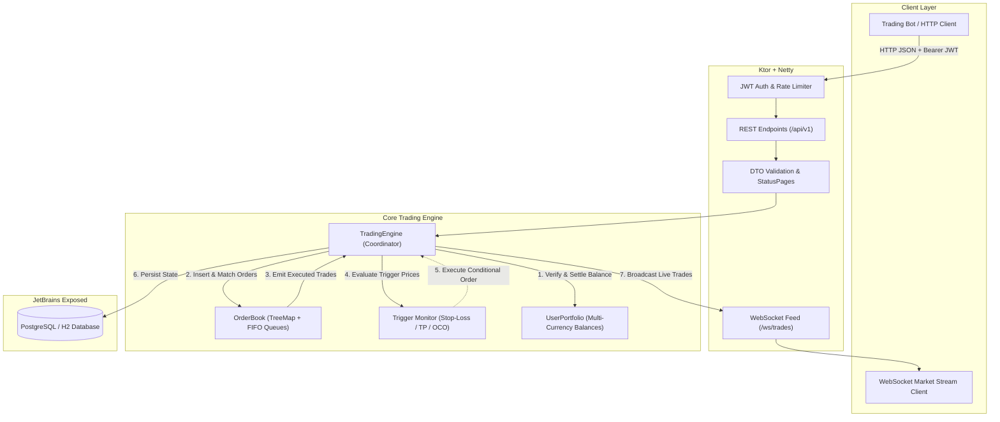
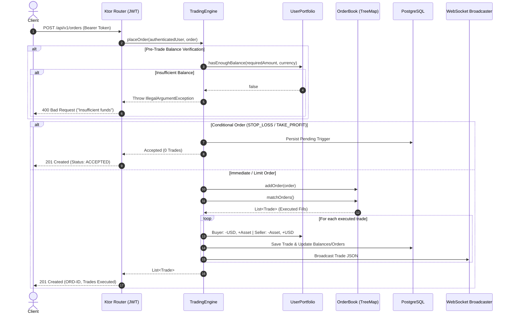

<div align="center">

# 🪙 Kotlin Trading Engine

**A persistent order matching engine, real-time WebSocket broadcaster, and secured REST API built with Kotlin 2.0, Ktor, and PostgreSQL.**

A clean, domain-driven exchange core implementing a continuous double-auction order book (`TreeMap` + FIFO queues), deterministic order execution (Limit, Market, Stop-Loss, Take-Profit, OCO), atomic balance accounting, JWT authentication, rate limiting, and database crash recovery.

> 🚀 **Project Status: Functional Backend Prototype**  
> This project demonstrates core exchange mechanics, algorithmic order matching, real-time streaming, and clean architecture on the JVM. See the [Technical Trade-offs & Planned Evolutions](#-technical-trade-offs--planned-evolutions) section for current design choices and future optimizations.

[](https://kotlinlang.org/)
[](https://adoptium.net/)
[](https://ktor.io/)
[](https://www.postgresql.org/)
[](#license)

</div>

---

## 📑 Table of Contents

- [Overview](#-overview)
- [How It Works (System Architecture)](#-how-it-works-system-architecture)
- [Order Lifecycle & Execution Logic](#-order-lifecycle--execution-logic)
  - [Supported Order Types](#supported-order-types)
  - [OCO (One-Cancels-the-Other) Orchestration](#oco-one-cancels-the-other-orchestration)
  - [Pre-Trade Balance Checks & Settlement](#pre-trade-balance-checks--settlement)
- [Technical Trade-offs & Planned Evolutions](#-technical-trade-offs--planned-evolutions)
  - [1. Why `BigDecimal` is used now & What will replace it](#1-why-bigdecimal-is-used-now--what-will-replace-it)
  - [2. Price-Level Bucketing (`TreeMap` + `ArrayDeque`)](#2-price-level-bucketing-treemap--arraydeque)
  - [3. Concurrency & Concurrency Model](#3-concurrency--concurrency-model)
- [Project Directory Structure](#-project-directory-structure)
- [REST & WebSocket API Specification (v1)](#-rest--websocket-api-specification-v1)
- [Getting Started & Local Setup](#-getting-started--local-setup)
- [End-to-End Simulation Walkthrough](#-end-to-end-simulation-walkthrough)
- [Testing & Verification](#-testing--verification)
- [Roadmap & Planned Next Steps](#-roadmap--planned-next-steps)
- [License](#-license)

---

## 📌 Overview

This project is a persistent **Order Matching & Trading Engine** designed to explore the mechanics behind modern financial exchanges and cryptocurrency spot markets.

Rather than relying on third-party trading libraries, the matching logic, order books, trigger monitors, and balance ledgers are implemented from scratch in pure Kotlin, backed by PostgreSQL persistence (JetBrains Exposed) and exposed via a JWT-secured REST API and WebSocket feed built with Ktor.

### Key Goals
- **Financial Precision:** Absolute protection against floating-point rounding errors using `BigDecimal`.
- **Fair & Fast Execution:** Price-Time Priority (FIFO) matching backed by `TreeMap` price buckets and `ArrayDeque` queues.
- **Persistence & Recovery:** Automatic state reload of active limit orders, pending triggers, and user wallets on server startup.
- **Security & Validation:** JWT bearer authentication, IP-based rate limiting, and strict DTO payload validation.

---

## 🏗️ How It Works (System Architecture)

The system is split into the **Transport & Security Gateway** (Ktor REST, WebSockets, JWT Auth, Rate Limiting, StatusPages), the **Core Engine** (order matching, trigger monitoring, and balance ledger), and the **Persistence Layer** (JetBrains Exposed ORM + PostgreSQL/H2).



### Order Execution Sequence



---

## 🛡️ Order Lifecycle & Execution Logic

### Supported Order Types

- **`LIMIT`**: A price-capped order. Enters the `TreeMap` book and matches against existing opposing orders at the specified limit price or better. Unfilled balance rests in the FIFO queue.
- **`MARKET`**: Aggressive liquidity-taking order. Sweeps opposing orders immediately at current market depth. Rejects if opposing liquidity is empty.
- **`STOP_LOSS`**: Conditional risk mitigation order. Remains off-book until an executed trade crosses the stop price threshold, then fires as a `MARKET` order:
  - *Sell Stop-Loss:* Fires when $\text{Market Price} \le \text{Stop Price}$.
  - *Buy Stop-Loss:* Fires when $\text{Market Price} \ge \text{Stop Price}$.
- **`TAKE_PROFIT`**: Conditional profit-securing order:
  - *Sell Take-Profit:* Fires when $\text{Market Price} \ge \text{Target Price}$.
  - *Buy Take-Profit:* Fires when $\text{Market Price} \le \text{Target Price}$.

### OCO (One-Cancels-the-Other) Orchestration

An OCO group connects two conditional orders (e.g., Take-Profit and Stop-Loss) under a shared `ocoGroupId`:

```
                 ┌────────────────────────────────┐
                 │       OCO Order Pair Placed    │
                 │  (Take-Profit + Stop-Loss)     │
                 └───────────────┬────────────────┘
                                 │
                     Market Price Changes
                                 │
         ┌───────────────────────┴───────────────────────┐
         ▼                                               ▼
┌──────────────────────────────┐                ┌──────────────────────────────┐
│  Take-Profit Price Triggered │                │   Stop-Loss Price Triggered  │
├──────────────────────────────┤                ├──────────────────────────────┤
│ 1. Fire Market Order         │                │ 1. Fire Market Order         │
│ 2. Remove linked Stop-Loss   │                │ 2. Remove linked Take-Profit │
└──────────────────────────────┘                └──────────────────────────────┘
```

When either order triggers or is manually cancelled, the matching engine purges the counterpart order from both memory and the database to eliminate double-spend risk.

### Pre-Trade Balance Checks & Settlement

Before any order is placed on the order book:

1. **Buy Order:** The engine verifies that user has $\text{Free USD} \ge \text{Price} \times \text{Quantity}$.
2. **Sell Order:** The engine verifies that user has $\text{Free Base Asset} \ge \text{Quantity}$.
3. **Settlement:** When trades match, `processTrade()` synchronously shifts balances between buyer and seller wallets and persists the updated state.

---

## ⚖️ Technical Trade-offs & Planned Evolutions

### 1. Why `BigDecimal` is used now & What will replace it

- **Current Choice (`java.math.BigDecimal`):**  
  Standard `Double` or `Float` cannot be used in financial applications due to IEEE 754 representation issues (e.g., `0.1 + 0.2 = 0.30000000000000004`). `BigDecimal` guarantees exact decimal arithmetic across the engine and PostgreSQL numeric columns.
- **The Drawback:**  
  `BigDecimal` is an immutable heap object. Every arithmetic operation creates new heap allocations, leading to Garbage Collector (GC) churn under extreme throughput.
- **Future Replacement:**  
  **Fixed-Point Integer Representation (`Long` / Kotlin `value class`):**  
  Representing prices and quantities as 64-bit integer units scaled by a fixed multiplier (e.g., $10^8$ for Bitcoin satoshis):
```kotlin
@JvmInline
value class Price(val raw: Long)
```

### 2. Price-Level Bucketing (`TreeMap` + `ArrayDeque`)

- **Current Implementation:**  
  Refactored from linear `mutableListOf` sorting to `TreeMap<BigDecimal, ArrayDeque<Order>>` (with `Collections.reverseOrder()` for bids).
- **Performance Impact:**  
  - Finding the Best Bid and Best Ask is now $\mathcal{O}(1)$ via `firstEntry()`.
  - Inserting an order into a price bucket is $\mathcal{O}(\log P)$ (where $P$ is the number of distinct price levels) with $\mathcal{O}(1)$ FIFO queue append.
  - Calling `.flatten()` converts nested queues into flat order lists for serialization when querying depth.
- **Future Evolution:**  
  Adding a secondary `HashMap<OrderId, OrderNode>` index with intrusive doubly-linked lists to achieve $\mathcal{O}(1)$ order cancellation.

### 3. Concurrency & Concurrency Model

- **Current State:**  
  Synchronous execution inside Netty worker threads and Exposed database transactions.
- **Future Evolution:**  
  **Single-Writer Architecture (Disruptor / Actor Pattern):**  
  Publishing incoming commands to a lock-free ring buffer (LMAX Disruptor or Kotlin Coroutine `Channel`), where a single dedicated thread processes order book mutations sequentially without lock contention.

---

## 📁 Project Directory Structure

```
TradingEngine/
├── src/
│   ├── main/
│   │   └── kotlin/
│   │       ├── Main.kt                     # Application entry point, DB init & Netty server
│   │       ├── database/
│   │       │   ├── DatabaseFactory.kt      # Exposed connection pool & schema setup
│   │       │   └── Tables.kt               # PostgreSQL/H2 table definitions
│   │       ├── dto/
│   │       │   └── OrderDtos.kt            # REST DTOs, input validation & domain mappers
│   │       ├── engine/
│   │       │   ├── Order.kt                # Order domain model & enums
│   │       │   ├── OrderBook.kt            # TreeMap + FIFO order book & matching logic
│   │       │   ├── Trade.kt                # Executed trade transaction record
│   │       │   ├── TradingEngine.kt        # Multi-symbol coordinator, triggers & recovery
│   │       │   └── UserPortfolio.kt        # Wallet balance ledger & settlement
│   │       ├── repository/
│   │       │   ├── OrderRepository.kt      # Active & trigger order persistence
│   │       │   ├── PortfolioRepository.kt  # User wallet persistence
│   │       │   └── TradeRepository.kt      # Executed trade history persistence
│   │       ├── routes/
│   │       │   ├── Routing.kt              # Ktor HTTP endpoints & StatusPages
│   │       │   ├── Security.kt             # JWT authentication & IP rate limiting
│   │       │   └── WebSockets.kt           # Real-time trade stream broadcaster
│   │       └── util/
│   │           └── CurrencyUtils.kt        # Symbol & currency parsing helpers
│   └── test/
│       └── kotlin/
│           ├── OrderBookTest.kt            # Matching, FIFO priority & TreeMap unit tests
│           ├── TradeTest.kt                # Trade value computation tests
│           ├── TradingEngineTest.kt        # Integration tests (Stop-Loss, TP, OCO, DB)
│           └── UserPortfolioTest.kt        # Balance deposit & invariant tests
├── build.gradle.kts                        # Gradle build & dependencies
├── settings.gradle.kts                     # Project settings
└── README.md                               # Project documentation
```

---

## 📡 REST & WebSocket API Specification (v1)

**Base URL:** `http://localhost:8081/api/v1`  
**WebSocket Feed:** `ws://localhost:8081/ws/trades`

### Endpoints

| Method | Endpoint | Auth Required | Description | Status Codes |
| :---: | :--- | :---: | :--- | :---: |
| `POST` | `/login` | No | Authenticate user and receive a JWT Bearer token | `200`, `400` |
| `GET` | `/orderbook/{symbol}` | No | Fetch current depth of bids and asks | `200`, `400` |
| `POST` | `/orders` | **JWT** | Submit a new order (LIMIT, MARKET, STOP_LOSS, TP, OCO) | `201`, `400`, `401` |
| `DELETE` | `/orders/{symbol}/{id}` | **JWT** | Cancel an active book order or pending trigger | `200`, `400`, `401`, `404` |
| `POST` | `/wallet/deposit` | **JWT** | Deposit funds into authenticated user's wallet | `200`, `400`, `401` |
| `GET` | `/wallet` | **JWT** | Retrieve wallet balances for authenticated user | `200`, `401` |
| `GET` | `/trades` | **JWT** | Retrieve filled trade history for authenticated user | `200`, `401` |
| `WS` | `/ws/trades` | No | Real-time JSON stream of executed trades | `101` |

---

### Request & Response Examples

#### 1. Authenticate & Obtain JWT

`POST /api/v1/login`

```json
{
  "userId": "usr_alice"
}
```

Response `200 OK`:

```json
{
  "token": "eyJhbGciOiJIUzI1NiIsInR5cCI6IkpXVCJ9..."
}
```

#### 2. Deposit Funds

`POST /api/v1/wallet/deposit`  
Header: `Authorization: Bearer <TOKEN>`

```json
{
  "amount": "100000.00",
  "currency": "USD"
}
```

Response `200 OK`: `"Deposit successful."`

#### 3. Submit Limit Order

`POST /api/v1/orders`  
Header: `Authorization: Bearer <TOKEN>`

```json
{
  "symbol": "BTC",
  "price": "60000.00",
  "quantity": "1.50",
  "side": "BUY",
  "execution": "LIMIT"
}
```

Response `201 Created`:

```json
{
  "orderId": "ORD-1729510000000",
  "status": "ACCEPTED",
  "message": "Order accepted. Trades created: 0"
}
```

#### 4. View Balances

`GET /api/v1/wallet`  
Header: `Authorization: Bearer <TOKEN>`

Response `200 OK`:

```json
{
  "userId": "usr_alice",
  "balances": {
    "USD": "10000.00",
    "BTC": "1.50"
  }
}
```

---

## 🚀 Getting Started & Local Setup

### Prerequisites

- **JDK 21** or later
- **PostgreSQL** (running on port `5432` with database `trading_db`, user `postgres`, password `postgrespassword`)
- **Gradle 8.x+** (or the included `./gradlew` wrapper)

### Build and Run

```bash
git clone https://github.com/botacz/TradingEngine.git
cd TradingEngine
./gradlew build
./gradlew run
```

The server starts on `http://localhost:8081`.

---

## 🧪 End-to-End Simulation Walkthrough

### PowerShell (Windows)

```powershell
$ALICE_TOKEN = (curl.exe -s -X POST http://localhost:8081/api/v1/login -H "Content-Type: application/json" -d '{\"userId\":\"usr_alice\"}' | ConvertFrom-Json).token
$BOB_TOKEN = (curl.exe -s -X POST http://localhost:8081/api/v1/login -H "Content-Type: application/json" -d '{\"userId\":\"usr_bob\"}' | ConvertFrom-Json).token

curl.exe -X POST http://localhost:8081/api/v1/wallet/deposit -H "Content-Type: application/json" -H "Authorization: Bearer $ALICE_TOKEN" -d '{\"amount\":\"100000.00\",\"currency\":\"USD\"}'
curl.exe -X POST http://localhost:8081/api/v1/wallet/deposit -H "Content-Type: application/json" -H "Authorization: Bearer $BOB_TOKEN" -d '{\"amount\":\"2.00\",\"currency\":\"BTC\"}'

curl.exe -X POST http://localhost:8081/api/v1/orders -H "Content-Type: application/json" -H "Authorization: Bearer $ALICE_TOKEN" -d '{\"symbol\":\"BTC\",\"price\":\"60000.00\",\"quantity\":\"1.50\",\"side\":\"BUY\",\"execution\":\"LIMIT\"}'
curl.exe -X POST http://localhost:8081/api/v1/orders -H "Content-Type: application/json" -H "Authorization: Bearer $BOB_TOKEN" -d '{\"symbol\":\"BTC\",\"price\":\"60000.00\",\"quantity\":\"1.50\",\"side\":\"SELL\",\"execution\":\"LIMIT\"}'

curl.exe http://localhost:8081/api/v1/wallet -H "Authorization: Bearer $ALICE_TOKEN"
curl.exe http://localhost:8081/api/v1/wallet -H "Authorization: Bearer $BOB_TOKEN"
```

### Bash (Linux / macOS)

```bash
ALICE_TOKEN=$(curl -s -X POST http://localhost:8081/api/v1/login -H "Content-Type: application/json" -d '{"userId":"usr_alice"}' | jq -r .token)
BOB_TOKEN=$(curl -s -X POST http://localhost:8081/api/v1/login -H "Content-Type: application/json" -d '{"userId":"usr_bob"}' | jq -r .token)

curl -s -X POST http://localhost:8081/api/v1/wallet/deposit -H "Content-Type: application/json" -H "Authorization: Bearer $ALICE_TOKEN" -d '{"amount":"100000.00","currency":"USD"}'
curl -s -X POST http://localhost:8081/api/v1/wallet/deposit -H "Content-Type: application/json" -H "Authorization: Bearer $BOB_TOKEN" -d '{"amount":"2.00","currency":"BTC"}'

curl -s -X POST http://localhost:8081/api/v1/orders -H "Content-Type: application/json" -H "Authorization: Bearer $ALICE_TOKEN" -d '{"symbol":"BTC","price":"60000.00","quantity":"1.50","side":"BUY","execution":"LIMIT"}'
curl -s -X POST http://localhost:8081/api/v1/orders -H "Content-Type: application/json" -H "Authorization: Bearer $BOB_TOKEN" -d '{"symbol":"BTC","price":"60000.00","quantity":"1.50","side":"SELL","execution":"LIMIT"}'

curl -s http://localhost:8081/api/v1/wallet -H "Authorization: Bearer $ALICE_TOKEN"
curl -s http://localhost:8081/api/v1/trades -H "Authorization: Bearer $ALICE_TOKEN"
```

---

## 🔬 Testing & Verification

Run the automated test suite (uses isolated in-memory H2 database):

```bash
./gradlew test
```

- **`OrderBookTest`**: Validates `TreeMap` price ordering, FIFO priority, partial fills, and cancellation.
- **`TradingEngineTest`**: Comprehensive integration tests for Stop-Loss execution, Take-Profit execution, OCO auto-cancellation, and database persistence.
- **`UserPortfolioTest`**: Tests balance checks, overdraft prevention, and ledger adjustments.
- **`TradeTest`**: Tests total value computation and calculations across currencies.

---

## 🔮 Roadmap & Planned Next Steps

- [x] **Data Structure Refactoring:** Replaced `mutableListOf` with `TreeMap<BigDecimal, ArrayDeque<Order>>` for $\mathcal{O}(1)$ best bid/ask and $\mathcal{O}(\log P)$ insertion.
- [x] **Real-Time Market Data Feeds:** Added Ktor WebSockets (`/ws/trades`) for streaming live tick-by-tick executed trades.
- [x] **REST API & Validation Enhancements:** Exposed conditional order fields, added strict positive-number validation, and configured Ktor `StatusPages` for clean HTTP 400 error responses.
- [x] **Security, Authentication & Rate Limiting:** Secured private routes with JWT Bearer tokens (`HMAC256`) and added IP-based Token Bucket rate limiting.
- [x] **Database & Persistence:** Integrated PostgreSQL/H2 using JetBrains Exposed for persistent portfolios, orders, triggers, and trade history.
- [ ] **O(1) Order Cancellation Index:** Add a `HashMap<OrderId, OrderNode>` with intrusive doubly-linked lists for constant-time cancellations.
- [ ] **Fixed-Point Primitive Accounting:** Replace heap-allocated `BigDecimal` with 64-bit integer fixed-point types (`Long` with $10^8$ scale) to reduce GC pressure.
- [ ] **Single-Writer Concurrency Model:** Introduce an LMAX Disruptor / Coroutine `Channel` loop to eliminate lock contention.
- [ ] **Benchmarking & Containerization:** Add JMH throughput benchmarks and a `docker-compose.yml` setup for one-command deployment.

---

## 📄 License

This project is licensed under the **MIT License** — see the [LICENSE](LICENSE) file for details.

---

<div align="center">
  <sub>Developed by <a href="https://github.com/botacz">botacz</a>.</sub>
</div>
